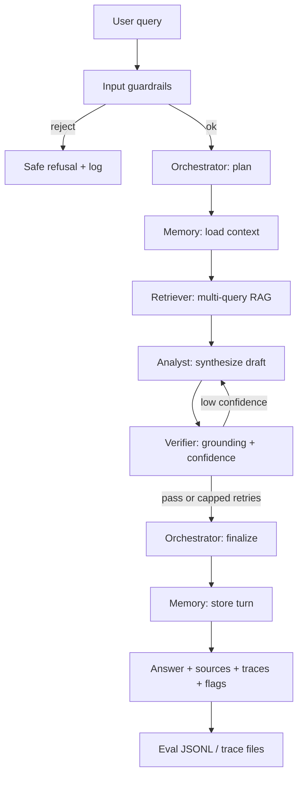

# Enterprise Knowledge Ops Agent — Architecture

Local multi-agent system for grounded, explainable answers over enterprise policies and SOPs. Stack: **Python · LangChain · LangGraph · Chroma · Azure OpenAI / OpenAI / mock fallback**.

## Design goals

| Goal | How it is met |
|------|----------------|
| Complex multi-doc questions | Orchestrator decomposes; Retriever pulls across collections; Analyst synthesizes |
| Distinct agent roles | Separate LangGraph nodes with typed shared state |
| Grounding & governance | Verifier citation checks + confidence flags; input guardrails |
| Explainability | Decision traces, retrieval logs, validation flags, structured eval JSONL |
| Demo without cloud keys | Deterministic mock LLM when Azure/OpenAI env is absent |

## Agent roles

| Role | Responsibility |
|------|----------------|
| **Orchestrator** | Validate input, plan sub-queries, route work, assemble final response envelope |
| **Retriever** | Embed query (and sub-queries), search Chroma, return ranked chunks with metadata |
| **Analyst** | Reason across retrieved evidence; draft answer with inline source refs |
| **Verifier** | Check claims against sources; score grounding/confidence; flag low-confidence answers |
| **Memory** | Persist short-term session notes and prior Q/A for follow-ups |

## Shared graph state

```text
KnowledgeOpsState
├── query / sub_queries
├── plan (steps, rationale)
├── retrieved_docs[{id, text, source, score}]
├── draft_answer
├── verified_answer
├── validation{ grounded, confidence, flags[], unsupported_claims[] }
├── memory_context
├── traces[{agent, event, detail, ts}]
├── eval_log{ metrics... }
└── disclaimers[]
```

## End-to-end flow



Retry from Verifier → Analyst is capped (default 1) to avoid loops; if still weak, the Orchestrator returns a limited answer with explicit flags and disclaimers.

## Planning & orchestration

1. Orchestrator normalizes the question and emits a **plan**: 1–N retrieval sub-queries plus a synthesis objective.
2. Sub-queries target different facets (e.g. policy vs SOP vs exception path) so retrieval spans documents.
3. Routing is deterministic in the graph: `orchestrate → memory_load → retrieve → analyze → verify → (optional re-analyze) → finalize → memory_store`.

## Retrieval & RAG

- **Ingest**: markdown/text under `data/sample_docs/` → chunk (size/overlap configurable) → embed → Chroma persistence (`./.chroma`).
- **Query time**: each sub-query retrieves top-k; results are deduped by chunk id and merged by score.
- **Embeddings**: Azure/OpenAI embedding model when configured; otherwise a local hash/bag-of-words style fallback embedding so demos run offline (quality is lower; documented in README).

## Reasoning & synthesis

Analyst receives: original query, plan, memory snippets, and ranked evidence. It must:

- Answer only from evidence (or state gaps explicitly)
- Cite sources as `[source:filename#chunk]`
- Keep structure suitable for Verifier (claims separable from fluff)

## Validation, grounding & guardrails

**Input (pre-graph):** length limits, empty/injection heuristics, blocked-pattern refusals.

**Output (Verifier):**

- Every substantive claim should map to ≥1 retrieved chunk
- Confidence from overlap / citation coverage / LLM self-score (mock uses lexical overlap)
- Flags: `ungrounded_claim`, `low_confidence`, `insufficient_context`, `guardrail_triggered`

**Attribution:** final payload always includes sources list + disclaimer when confidence is below threshold.

## Observability & evaluation

Each run writes:

- **In-memory / response traces**: agent events for UI and CLI
- **Structured eval log** (`logs/eval.jsonl`): query id, latency, retrieval counts, grounding score, confidence, flags, pass/fail rubric hooks
- **Trace file** (`logs/traces/<run_id>.json`): full decision trail

See [evaluation-guardrails.md](./evaluation-guardrails.md).

## Package layout (repo)

```text
src/knowledge_ops/
  config.py          # env + paths
  llm.py             # Azure / OpenAI / mock
  state.py           # TypedDict graph state
  ingest.py          # doc → Chroma
  guardrails.py      # input + output helpers
  eval_logging.py    # JSONL + traces
  agents/            # orchestrator, retriever, analyst, verifier, memory
  graph.py           # LangGraph wiring
app/cli.py           # CLI entry
app/streamlit_app.py # optional UI
data/sample_docs/    # policies & SOPs
tests/               # unit tests
```

## AWS deployment note (out of scope for runtime)

Local correctness is the primary runtime. For a later AWS landing zone (not required to run this case study):

| Component | Suggested AWS mapping |
|-----------|------------------------|
| API / workers | ECS Fargate or Lambda + API Gateway |
| Vector store | OpenSearch Serverless or Aurora + pgvector (replace Chroma) |
| Secrets | Secrets Manager / SSM for Azure OpenAI keys |
| Artifacts / docs | S3 for source corpus; sync into ingest job |
| Observability | CloudWatch Logs + optional X-Ray; ship `eval.jsonl` to S3 |
| UI | Streamlit on ECS or Amplify static front-end calling the API |

No production IAM, VPC, or multi-tenant auth is implemented here (explicitly out of scope).

## Non-goals

Cloud scale, enterprise SSO/ACL, model fine-tuning, and polished product UI remain out of scope per the case study requirements (complex multi-doc Q&A with planning, grounding, guardrails, and local focus).
